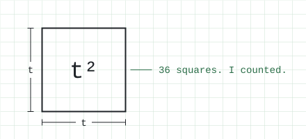

# t-sqrd

<picture>
  <source media="(prefers-color-scheme: dark)" srcset="t-sqrd-dark.svg">
  
</picture>

t × t. I checked the math.

Most of what I write lives in private repos, so this page is a lot quieter than my commit history.
